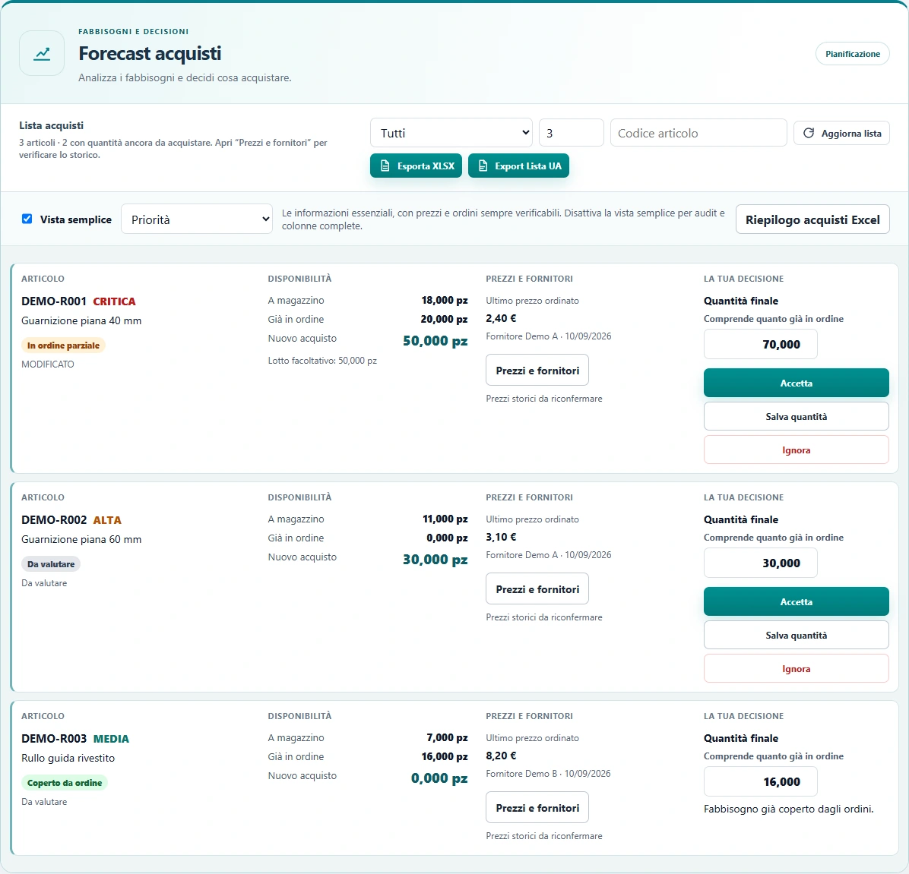
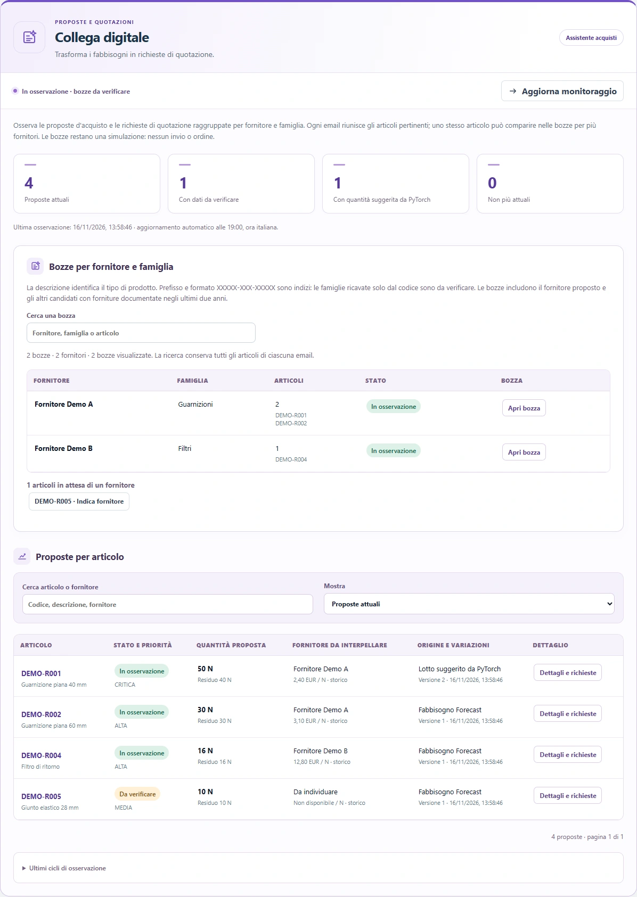
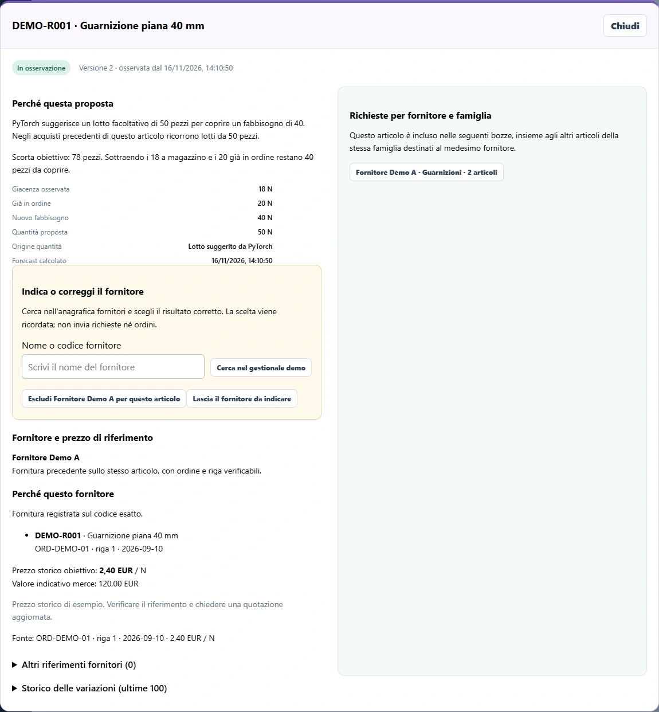
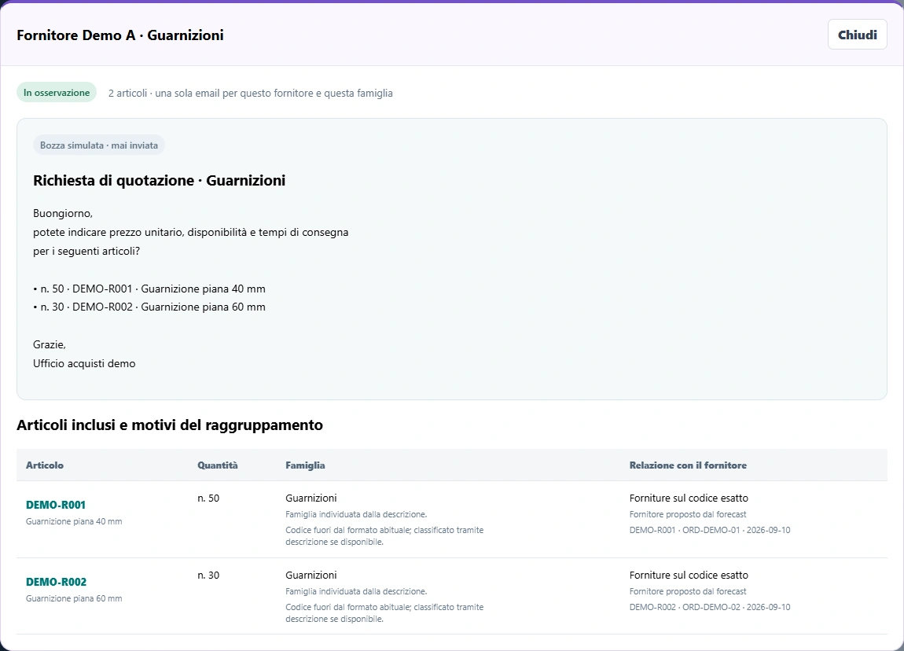
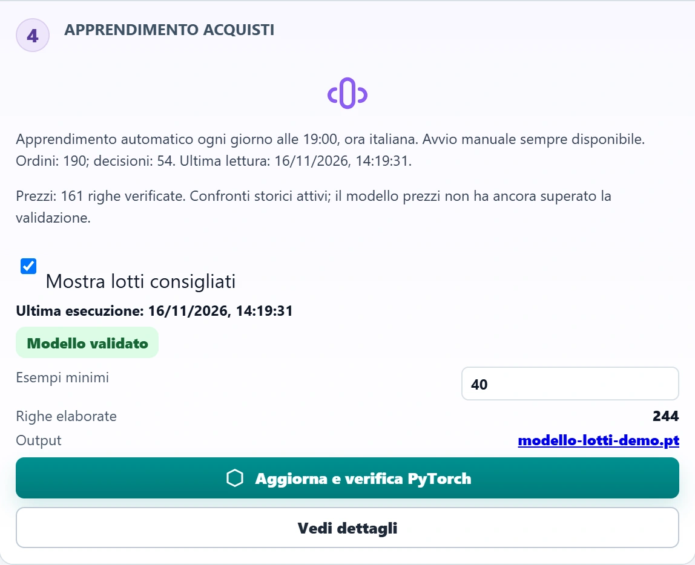
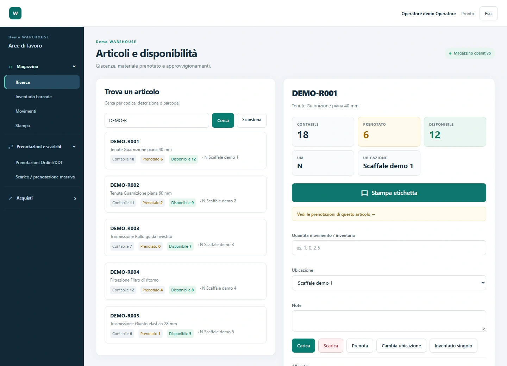

# Logistica di magazzino e Forecast acquisti

Portfolio di una web app per gestire un magazzino ricambi e pianificare gli acquisti. Il progetto collega il lavoro a scaffale alle decisioni di riordino: dalla ricerca di un articolo e dai movimenti di stock fino al fabbisogno residuo e alla preparazione di una richiesta di quotazione.

[Tavolo di lavoro Forecast](#forecast-acquisti) · [Collega digitale e AI](#collega-digitale-e-ai) · [Apprendimento acquisti](#apprendimento-acquisti) · [Operatività di magazzino](#operatività-di-magazzino) · [Architettura](#architettura)

Le schermate sono catturate dalle interfacce del software in una demo isolata. Articoli, ubicazioni, fornitori, importi e volumi sono inventati.

## Forecast acquisti

Quando un articolo scende sotto il livello desiderato, prima di acquistare serve capire quanto materiale è già in arrivo. Il Forecast legge consumi e trend, tiene conto del lead time (il tempo di approvvigionamento) e stima la scorta obiettivo. Incrocia poi la giacenza con gli ordini aperti per distinguere le quantità già coperte da quelle ancora da acquistare.

*La vista compatta mette a confronto giacenza, quantità in arrivo e nuovo acquisto. La vista completa aggiunge le evidenze del calcolo e dell'audit.*

- **Priorità e copertura:** filtri per urgenza, trend, lead time e disponibilità dello storico. Un articolo già coperto dagli ordini rimane consultabile senza generare un nuovo acquisto.
- **Verifica economica:** confronto dei prezzi storici e dei fornitori, con riferimenti all'ordine di origine. Il prezzo storico va riconfermato con il fornitore.
- **Decisione tracciata:** l'ufficio acquisti può accettare la proposta, modificare la quantità finale o ignorarla. Le decisioni alimentano lo storico e la lista acquisti esportabile in Excel.

## Collega digitale e AI

Il **Collega digitale** trasforma i fabbisogni residui in una coda di proposte da verificare. Per ogni articolo espone la motivazione, l'origine della quantità, i riferimenti storici del fornitore e le variazioni nel tempo. Se mancano dati affidabili, il caso resta in evidenza per l'operatore.

*Il monitor distingue le proposte correnti, quelle con dati da verificare e quelle in cui interviene un consiglio di PyTorch.*

| Componente | Compito |
| --- | --- |
| **Motore Forecast** | Calcola il fabbisogno con regole deterministiche e riconcilia gli ordini aperti. |
| **PyTorch** | Può suggerire un lotto facoltativo a partire dallo storico. La pipeline di apprendimento usa partizioni temporali e confronta il candidato con regole di riferimento prima di renderne disponibili i consigli. |
| **Collega digitale** | Spiega la proposta e compone bozze per fornitore e famiglia. Registra le conferme e le esclusioni dei fornitori come correzioni consultabili. |
| **Ufficio acquisti** | Verifica quantità, fonti e fornitori. Le richieste mostrate restano bozze: il collega digitale non invia email e non emette ordini. |

**Un riordino in pratica.** Per la guarnizione demo, la scorta obiettivo è 78 pezzi. Con 18 a magazzino e 20 già in ordine, ne mancano 40. PyTorch suggerisce un lotto facoltativo di 50 pezzi. Se l'operatore lo sceglie, la quantità finale nella vista acquisti è 70: 20 già ordinati più 50 da acquistare. Il Collega digitale mostra i 50 pezzi nella bozza, insieme alle altre guarnizioni da chiedere allo stesso fornitore.

*Il dettaglio separa i 40 pezzi di fabbisogno dai 50 del lotto suggerito. L’operatore può controllare la giacenza e gli ordini già aperti, verificare il prezzo storico sulla riga d’ordine e correggere il fornitore prima di usare la bozza.*

*La bozza riunisce i due articoli in una sola richiesta e rende esplicita la ragione del raggruppamento. In assenza di uno storico sul codice o di una scelta umana verificata, il fornitore resta da indicare.*

### Apprendimento acquisti

*La scheda mostra l’ultimo ciclo, il modello disponibile e l’opzione per visualizzare i lotti consigliati. Conteggi ed esito nella schermata sono simulati.*

Gli esempi sono divisi per data: quelli più vecchi servono ad addestrare il modello, quelli successivi a scegliere quando fermare l’addestramento e i più recenti a misurare l’errore finale. Il modello dei lotti viene attivato solo se ci sono abbastanza esempi e sul test finale sbaglia meno della regola basata sui lotti storici. Se il nuovo candidato non supera i controlli, resta in uso il modello già validato, se disponibile; altrimenti il Forecast può mostrare i lotti preferiti o storici. Il consiglio resta facoltativo e il calcolo del fabbisogno rimane separato.

## Operatività di magazzino

La web app Warehouse è il punto di partenza per la ricerca di ricambi, la verifica a scaffale e la registrazione dei movimenti.

- **Consultazione:** ricerca per codice o descrizione, schede articolo, disponibilità distinta dal prenotato e vista delle ubicazioni.
- **Movimenti:** carichi, scarichi, inventario, operazioni massive e storico consultabile.
- **Attività a scaffale:** lettura di codici a barre, prenotazioni di materiale e stampa etichette, secondo i permessi dell'operatore.

## Architettura

Warehouse e Forecast sono due applicazioni web interne separate, con API dedicate e servizi eseguiti in container Docker su infrastruttura locale. I dati applicativi risiedono in MySQL. Le fonti gestionali sono consultate in sola lettura per allineare lo storico e gli ordini aperti. Un processo separato prepara e valuta i modelli PyTorch.

Il repository raccoglie la documentazione pubblica del progetto e le schermate dimostrative.
